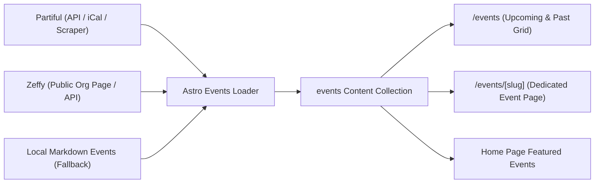

# NEU Website Modernization & Content Automation Plan

> [!NOTE]
> This plan builds on the Tailwind CSS v4 + DaisyUI v5 (`neu` theme) foundation now installed in `neu-astro`, and outlines a phased roadmap for accessible, responsive UI modernization and automated neighborhood content feeds.

---

## 1. Design System & UI Modernization (Accessible, Modular, Responsive)

### Current State
- **Foundation installed**: Tailwind CSS v4 (`@tailwindcss/vite`), DaisyUI v5 with a custom `neu` theme in [global.css](file:///home/allison/dev/neu/neu-astro/src/styles/global.css), and `data-theme="neu"` in [Layout.astro](file:///home/allison/dev/neu/neu-astro/src/layouts/Layout.astro).
- **Remaining legacy CSS**: Many pages and components (e.g., [Header.astro](file:///home/allison/dev/neu/neu-astro/src/components/Header.astro), resource subpages) still use custom WordPress/Astra-era CSS classes and duplicated inline arrays (e.g., ward/district contact cards defined in page frontmatter).

### Modernization Architecture
1. **Shared Data & Reusable UI Primitives (`src/components/ui/`)**
   - Extract reusable, accessible DaisyUI-backed Astro components:
     - `PageHero.astro`: Consistent responsive hero banner with eyebrow, `Cormorant Garamond` heading, intro copy, and optional map/media slot.
     - `DirectoryCard.astro`: Standardized card for Wards, State House Districts, Block Clubs, and Chambers (using DaisyUI `card`, `badge`, icon rows, `tel:` / `mailto:` links, and external CTA buttons).
     - `ResourceGrid.astro`: Responsive CSS Grid (`grid-cols-1 md:grid-cols-2 lg:grid-cols-3`) with consistent spacing and focus states.
   - Centralize duplicate contact/directory data into `src/data/` (or Astro Content Collections) so pages like [wards.astro](file:///home/allison/dev/neu/neu-astro/src/pages/resources/wards.astro) and [house-districts.astro](file:///home/allison/dev/neu/neu-astro/src/pages/resources/house-districts.astro) share a single source of truth with [maps.json](file:///home/allison/dev/neu/neu-astro/src/data/maps.json).

2. **Navigation, Mobile UX & Accessibility (WCAG 2.1 AA)**
   - **Header & Mobile Drawer**: Replace custom dropdown/hamburger CSS with DaisyUI `navbar`, `drawer`, and accessible disclosure menus (`aria-expanded`, `Escape` to close, focus trapping in mobile drawer).
   - **Color Contrast & Focus**: Audit `#d7935b` (primary) and `#90b4cb` (accent) text-on-background contrast; reserve `#d7935b` for large headings, borders, accents, and buttons with dark text (`#231f20`), while using `#244367` (secondary) for body text and interactive links.
   - **Responsive Maps**: Add mobile-friendly collapsible layer filter drawers on `MapboxMap.astro` (`
` or DaisyUI `collapse`) so the filter panel does not obscure the map on narrow viewports (`< 640px`).
   - **Pre-existing Build Issue to Resolve**: Fix the unclosed `
` inside `<aside class="cs-sidebar">` in [CompleteStreetsPlanner.astro](file:///home/allison/dev/neu/neu-astro/src/components/CompleteStreetsPlanner.astro#L230-L250), and configure `@typescript-eslint/parser` in [eslint.config.js](file:///home/allison/dev/neu/neu-astro/eslint.config.js) so ESLint validates `.astro` TypeScript frontmatter cleanly.

---

## 2. Automated Event Feeds (Partiful & Zeffy)

### Goal
Automatically generate and update event pages and event listings on `neu-astro` whenever NEU creates an event on **Partiful** or **Zeffy**, without manual copy-pasting.

### Recommended Architecture: Astro Content Layer Loaders + Scheduled Static Builds
Because `neu-astro` is a static Astro site (`output: "static"`), **Astro 5+ Content Layer Loaders** in [content.config.ts](file:///home/allison/dev/neu/neu-astro/src/content.config.ts) are the cleanest native fit:

1. **Unified Event Schema (`events` collection)**
   - Fields: `id`, `title`, `slug`, `startDate`, `endDate`, `location`, `description`, `image`, `source` (`'partiful' | 'zeffy' | 'local'`), `registrationUrl`, `ticketPrice`, `status` (`'upcoming' | 'past'`).
2. **Platform Integration Strategy**
   - **Zeffy**: Check if NEU's Zeffy organization account exposes a public JSON/GraphQL endpoint or embeddable event list feed, or sync via a lightweight build-time fetcher (or Zapier/Make webhook -> GitHub Actions `repository_dispatch` if Zeffy requires authenticated dashboard access).
   - **Partiful**: Partiful does not currently offer a general public REST API; options in order of reliability:
     1. **Calendar / iCal (`.ics`) or Email/Webhook Trigger**: Forward Partiful host confirmation/calendar invites or use a webhook automation to commit/trigger a rebuild.
     2. **Build-time Public Profile/Event URL Fetcher**: Maintain a list of Partiful event URLs (or host profile) and parse OpenGraph / JSON-LD (`schema.org/Event`) metadata at build time using a standard parser (`cheerio` + `ical.js`).
3. **Dynamic Routes & Automated Refresh**
   - Create `src/pages/events/index.astro` (filterable upcoming/past events, "Add to Calendar" `.ics` download) and `src/pages/events/[slug].astro` (full event details + direct Partiful/Zeffy RSVP CTA).
   - Add a **GitHub Actions cron workflow** (e.g., every 6 hours + manual `workflow_dispatch`) that rebuilds and deploys the static site via `scripts/deploy-ftp.py` whenever new events or news are fetched.

---

## 3. Neighborhood News Aggregator Feed

### Goal
Provide a curated, automatically updated "Edgewater & Uptown News" feed linking to recent articles from pre-selected local sources (e.g., *Block Club Chicago*, *Chicago Sun-Times*, *WTTW*, *Streetsblog Chicago*, *Edgewater Historical Society*, Aldermanic newsletters).

### Recommended Architecture: RSS/Atom Loader + Keyword/Tag Filtering
1. **Standard Library**: Use `rss-parser` (standard npm RSS/Atom parser) inside a custom Astro Content Loader (`news` collection) or build-time data script.
2. **Curated Source Configuration (`src/data/news-sources.json`)**
   - Store an explicit allowlist of sources: `{ name, feedUrl, siteUrl, category, keywordFilter? }`.
   - Filter broad citywide feeds (like *WTTW* or *Block Club Chicago*) by neighborhood keywords (`Edgewater`, `Uptown`, `Andersonville`, `Argyle`, `48th Ward`, `46th Ward`, `40th Ward`, `47th Ward`, `Clark St`, `Broadway`, `Sheridan`).
   - Normalize each item to `{ title, url, publishedAt, sourceName, summary, imageUrl? }`, deduplicate by canonical URL, and sort descending by date.
3. **UI Presentation**
   - Add a `/news` page (or `/resources/news`) and a compact "Latest Neighborhood News" widget on the homepage using DaisyUI `card` / `list` components with clear external-link indicators (`rel="noopener noreferrer"` + source badge + relative date).
   - Graceful fallback: Cache the last successful fetch in a committed JSON snapshot or fallback gracefully if an upstream RSS feed times out during build.

---

## 4. Phased Implementation Roadmap

| Phase | Scope | Key Deliverables |
| :--- | :--- | :--- |
| **Phase 1: UI Foundation & Build Health** | Fix pre-existing build/lint blockers; standardize layout primitives | Fix [CompleteStreetsPlanner.astro](file:///home/allison/dev/neu/neu-astro/src/components/CompleteStreetsPlanner.astro#L230-L250) `</aside>` tag; configure ESLint TS parser; create `PageHero`, `DirectoryCard`, and mobile-friendly `Header` drawer with Tailwind + DaisyUI |
| **Phase 2: News Aggregator Feed** | Automated neighborhood news links | Install `rss-parser`; create `src/data/news-sources.json` and `news` Content Loader; build `/news` page & homepage news widget |
| **Phase 3: Events Automation (Partiful & Zeffy)** | Automated event pages & calendar | Define `events` Content Collection; implement Partiful/Zeffy loader(s); build `/events` and `/events/[slug]` pages |
| **Phase 4: Scheduled CI/CD** | Hands-free content updates | Add GitHub Actions scheduled build + `deploy-ftp.py` workflow so events and news stay fresh automatically |
